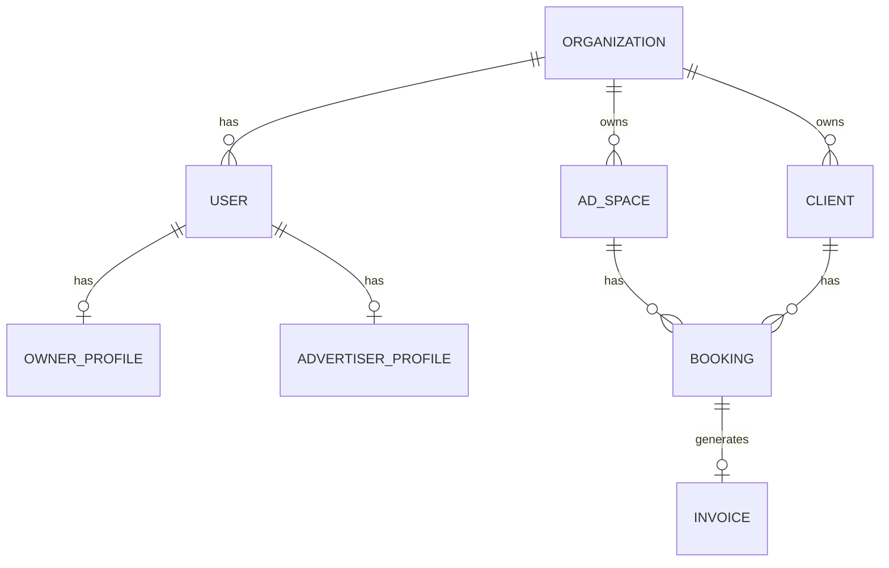

# Phase 1 — Data Model

## Entity relationship (overview)



## Critical principle

**Separate IMD from marketplace:** `imd_status` and `marketplace_listing_status` on AdSpaces are independent. An owner may have 100 AdSpaces in IMD but only 30 publicly listed (Phase 2).

---

## Entities (Phase 1)

### Organization (tenant / "Company")

| Field | Type | Required | Notes |
|-------|------|----------|-------|
| id | UUID | yes | PK |
| name | string | yes | Organization / company name |
| brand_name | string | no | Brand display name |
| email | string | yes | Official email, unique |
| sector | string | no | Sector/category |
| contact_person | string | no | |
| contact_phone | string | no | |
| branch_location | string | no | Main branch |
| type | enum | yes | `owner` \| `advertiser` |
| status | enum | yes | `active` \| `suspended` |
| created_at | timestamp | yes | |
| updated_at | timestamp | yes | |

---

### User

| Field | Type | Required | Notes |
|-------|------|----------|-------|
| id | UUID | yes | PK |
| email | string | yes | unique |
| password_hash | string | yes | bcrypt |
| email_verified_at | timestamp | no | |
| two_factor_enabled | boolean | no | default false |
| status | enum | yes | active, suspended, deleted |
| terms_accepted_at | timestamp | no | |

---

### OwnerProfile

| Field | Type | Required | Notes |
|-------|------|----------|-------|
| id | UUID | yes | PK |
| user_id | UUID | yes | FK → User |
| organization_id | UUID | yes | FK → Organization |
| date_of_birth | date | no | |
| agency_name | string | no | |
| office_address | jsonb | no | |
| total_ad_spaces_claimed | int | no | |
| verification_status | enum | yes | draft, submitted, under_review, approved, rejected |

---

### AdSpace

| Field | Type | Required | Notes |
|-------|------|----------|-------|
| id | UUID | yes | PK |
| organization_id | UUID | yes | tenant scope |
| ad_space_number | string | yes | unique per platform |
| name | string | yes | |
| ad_space_type_id | UUID | no | FK (seed types) |
| location_id | UUID | no | |
| dimensions | jsonb | no | size |
| base_price | decimal | no | |
| imd_status | enum | yes | draft, active, inactive, ... |
| marketplace_listing_status | enum | yes | default not_listed |

---

### Client

| Field | Type | Required | Notes |
|-------|------|----------|-------|
| id | UUID | yes | PK |
| organization_id | UUID | yes | owner's org |
| name | string | yes | |
| business_name | string | no | |
| email | string | no | |
| contact_phone | string | no | |

---

### Booking

| Field | Type | Required | Notes |
|-------|------|----------|-------|
| id | UUID | yes | PK |
| organization_id | UUID | yes | |
| ad_space_id | UUID | yes | |
| client_id | UUID | yes | |
| start_date | date | yes | |
| end_date | date | yes | end >= start |
| status | enum | yes | draft, confirmed, active, completed, cancelled |
| amount | decimal | no | |
| campaign_reference | string | no | |

**Constraint:** No overlapping confirmed/active bookings on same `ad_space_id`.

---

### Invoice

| Field | Type | Required | Notes |
|-------|------|----------|-------|
| id | UUID | yes | PK |
| organization_id | UUID | yes | |
| booking_id | UUID | yes | |
| invoice_number | string | yes | INV-{ORG}-{YYYY}-{SEQ} |
| total_amount | decimal | yes | |
| pdf_url | string | no | S3/R2 path |

---

## Enums

```typescript
enum OrganizationType {
  OWNER = 'owner',
  ADVERTISER = 'advertiser',
}

enum ImdStatus {
  DRAFT = 'draft',
  ACTIVE = 'active',
  INACTIVE = 'inactive',
  UNDER_MAINTENANCE = 'under_maintenance',
  TEMPORARILY_UNAVAILABLE = 'temporarily_unavailable',
  ARCHIVED = 'archived',
}

enum MarketplaceListingStatus {
  NOT_LISTED = 'not_listed',
  LISTED = 'listed',
  DELISTED = 'delisted',
}

enum VerificationStatus {
  DRAFT = 'draft',
  SUBMITTED = 'submitted',
  UNDER_REVIEW = 'under_review',
  APPROVED = 'approved',
  REJECTED = 'rejected',
}
```

---

## Tenant isolation rules

- Every IMD query filters by `organization_id` from authenticated user
- Admin may access cross-org read-only views
- Super admin users have `admin` role with no org scope

---

## Phase 2 placeholder tables (schema only)

- `marketplace_listings`
- `booking_requests`
- `campaigns`
- `payments`
